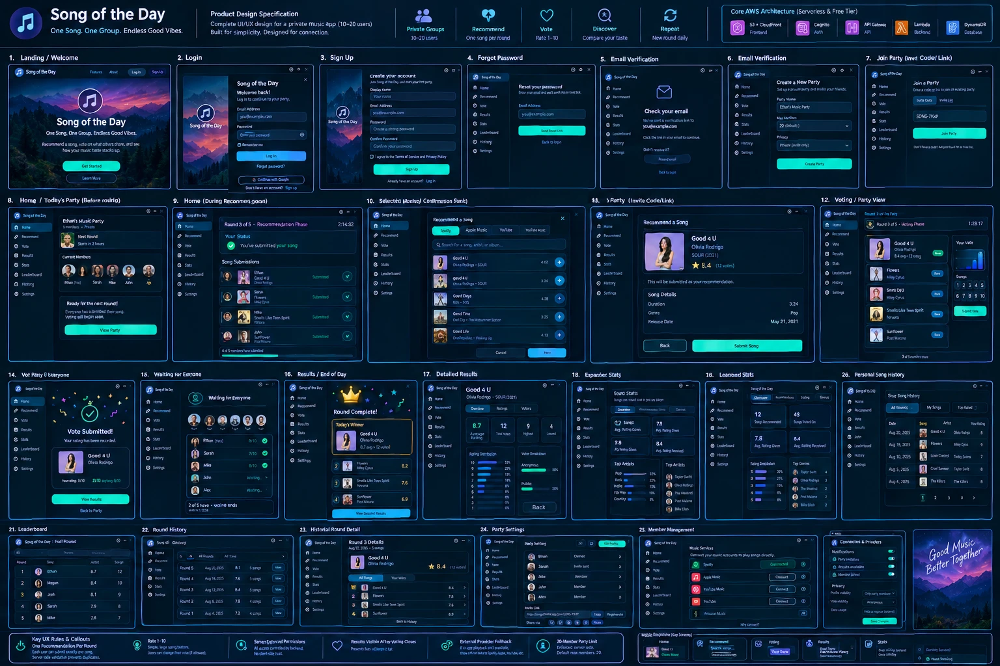
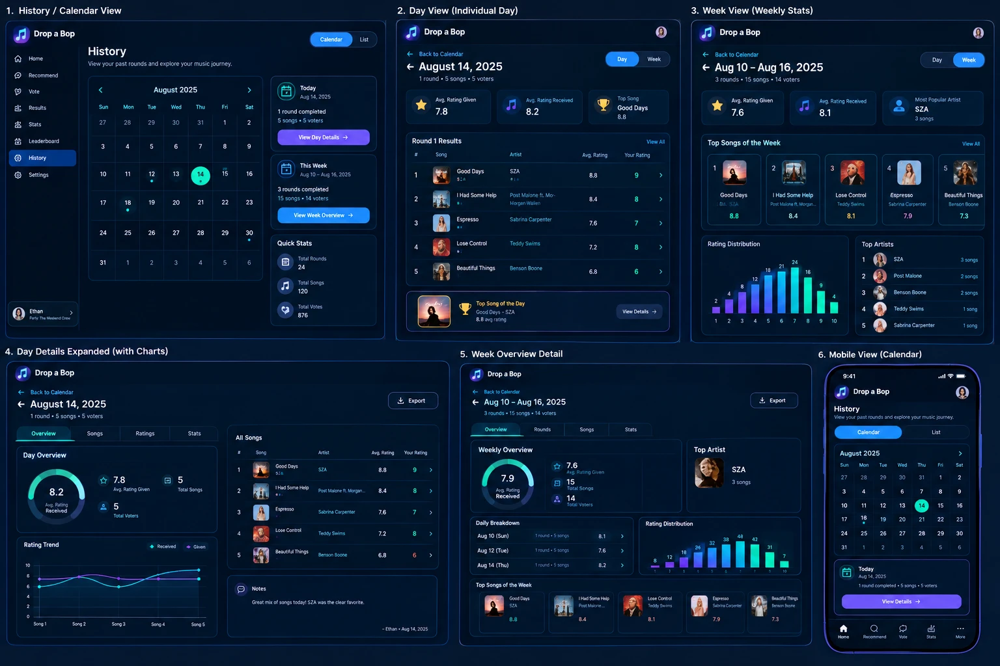
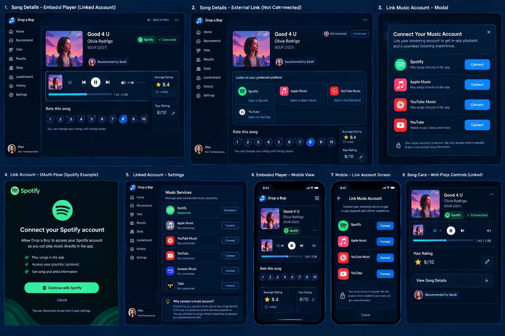
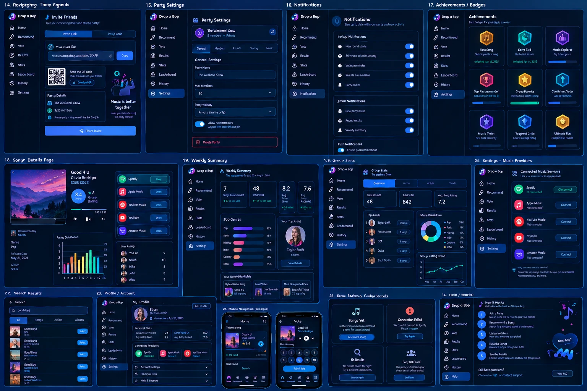

# Design reference

`mockup-v2-overview.webp` is the **approved second mockup direction** (spec §20), added by Ethan on 2026-10-01.
It's the primary **visual** reference: layout, colour, typography, components, and screen inventory.

**Precedence:** for *behaviour* (what's allowed, when things unlock, what's visible), follow
`docs/PRODUCT_DECISIONS.md` and ADR-0004. The mockup was drawn before the weekly model was decided, so some
screens show an older flow. The adaptations below say how to build those screens. When the mockup and the
decisions disagree, keep the mockup's look and follow the decisions' rules.

## Visual language (to be turned into tokens in P7.1)

Final tokens, sampled from the image in P7.1 and defined in `apps/web/src/index.css` (`@theme`). Use them as
Tailwind classes (`bg-surface`, `text-primary`, `border-line`, …). Contrast check of every text/background pair
happens in P8.12.

| Token | Value | Token | Value |
|---|---|---|---|
| `bg` | `#011420` | `primary` (teal) | `#00E7D0` |
| `surface` | `#01192B` | `primary-ink` (text on teal) | `#01231F` |
| `surface-raised` | `#022238` | `blue` | `#1AA4FE` |
| `active` (nav) | `#013A62` | `purple` | `#8B5CF6` |
| `line` (borders) | `#0D3352` | `gold` | `#F5C542` |
| `glow` | `#1AA4FE` | `success` | `#22C55E` |
| `ink` (text) | `#E6F1FF` | `muted` (text) | `#8BA3BF` |

Descriptions of the original look, kept for reference:

| Token | Looks like | Used for |
|---|---|---|
| `bg` | Very dark navy, near black | Page background |
| `surface` | Dark navy, slightly lighter than `bg` | Cards, panels, sidebar |
| `border-glow` | Thin neon-blue / cyan outline | Card and panel borders (subtle glow) |
| `primary` | Bright teal / cyan | Main buttons (Get Started, Log in, Join Party, Submit Song, View Results) |
| `accent-blue` | Neon blue | Active nav item, links, tabs, progress bars, play buttons |
| `accent-purple` | Purple / violet | Logo gradient, highlights, decorative gradients |
| `gold` | Warm gold / yellow | Winner crown, star ratings, "Today's Winner" card border |
| `success` | Green | "Submitted" / done checkmarks |
| `text` / `text-muted` | White / blue-grey | Body text / secondary text |

- **Shape:** rounded cards (about 12–16 px radius), pill-shaped buttons and tabs, circular avatars, square album
  art with small rounded corners.
- **Type:** clean sans-serif; large bold headings ("Song of the Day", "Round Complete!"); big numerals for stats
  (8.7, 12, 9, 4).
- **Imagery:** album art everywhere a song appears. Hero and auth screens use a purple-to-blue mountain-night
  illustration with the music-note logo in a gradient circle.
- **Charts:** horizontal bar distributions (rating 0–10, D36), simple donut/split bars (anonymous vs public), rank lists.

## Logo (2026-10-04)

Ethan's app icon (`apps/web/public/logo.png`, a dark rounded tile with a cyan→magenta music note and "Drop a Bop").
Derived files in `apps/web/public/`: `logo.webp` (big logo on the welcome and sign-in screens), `logo-mark.png` (the
note only, for the sidebar/header next to the name), `favicon-32/64.png`, `apple-touch-icon.png`, `icon-192/512.png`
(installed-app icons, `manifest.webmanifest`). The wordmark's "Bop" uses the icon's gradient
(`from-cyan-400 via-violet-500 to-fuchsia-500`). The sign-up / reset-code email is branded HTML and shows the logo
once the website is hosted (CloudFront), since email needs a public image address.

## Layout

Navigation follows D32 (built in P13.13, `apps/web/src/components/AppShell.tsx`):

- **Desktop/tablet sidebar:** logo, party switcher, then three groups: Home, Today's Drop, History, Stats,
  Leaderboard, Achievements, Search · Party, Members (jumps to the members card on Party settings), Settings ·
  Notifications, Profile, Sign out. Main content in cards to the right.
- **Mobile:** bottom bar **Home · Drop · History · Stats · Profile**. The header holds the logo, party switcher,
  notifications bell, Search and Settings. Leaderboard is reached from Stats' tabs, Achievements from Stats and
  Profile. Single-column cards.
- **Drop hub:** Share · Rate · Results tabs above those three screens (they keep their addresses). `/drop` opens the
  tab that fits right now: Share if you haven't shared on a sharing day, otherwise Rate during the week and Results
  between weeks. "Drop" stays highlighted on all three.
- **Auth screens** (Landing, Login, Sign Up, Forgot Password, Email Verification): illustration panel and form
  side by side on desktop; illustration becomes a header on mobile.

## Screen map: mockup → roadmap → adaptation

| Mockup # | Mockup screen | Roadmap | Adaptation for the weekly model |
|---|---|---|---|
| 1 | Landing / Welcome | P8.1 | Change "Recommend a song, vote on what others share" copy to describe the weekly flow. |
| 2–5 | Login, Sign Up, Forgot Password, Email Verification | P7.3 | **Hide "Continue with Google"** in v1 (email + password only; see "Open questions"). Sign Up's Terms checkbox becomes a short "By signing up you agree to the privacy note" link. |
| 6 | Create a New Party | P8.3 | Fields: party name, max members (default 20), timezone (detected). Drop "Privacy: Private (invite only)", since every party is private. |
| 7, 11 | Join Party (code / link) | P8.2 | As drawn. |
| 8 | Home / Today's Party (before round) | P8.3 | Becomes **Home / Today**: "Share today's song" call to action, members with today's ✓ status, countdown to Sunday 11:59 pm. "Next round starts in 3 hours" → shows on weekends as "New week starts Monday". |
| 9 | Home (during recommendation) | P8.3 | "Round 3 of 5 · Recommendation Phase" → **"Wednesday · Day 3 of 5"**. "Song Submissions" list = today's songs, anonymous (D10). Show **"3 of 5 shared today"** (a count). Per-person ✓ marks only when the party reveals recommenders, because names next to a song list would reveal whose song is whose. |
| 10 | Recommend a Song (search) | P8.4 | Provider tabs (Spotify / Apple Music / YouTube / YouTube Music) only for providers ADR-0007 actually supports; v1 is likely one search tab plus paste-a-link. |
| 11 (second panel) | Confirm recommendation | P8.4 | Title "Share today's song". Remove the song's star rating (it hasn't been rated yet). Add "You can't change it after sharing." |
| 12 | Voting / Party View | P8.5 | "Round 3 of 5 · Voting Phase" → **"This week's songs"**, grouped by day with an Unrated filter. The rating grid RatingControl stays as drawn, now 0–10 (D36: 11 buttons, 6 + 5 on phones). Hide recommender names (D10). |
| 14 | Vote Submitted | P8.5 | Becomes a lightweight "Rating saved ✓ · you can change it until ratings lock" confirmation (toast or inline). "View Results" → "Results unlock Sunday night". |
| 15 | Waiting for Everyone | P8.3 / P8.5 | **Must not show other people's scores** (the mockup shows "8/10, 7/10"). That breaks D9. Show progress only: how many have shared today (names only if recommenders are revealed), and your own "12 of 31 rated". |
| 16 | Results / End of Day ("Round Complete!", Today's Winner) | P8.6 | Becomes **Weekly Results** ("Week Complete!"): the crown card shows each day's **Bop of the Day** winner, then the full weekly ranking. |
| 17 | Detailed Results (Overview / Ratings / Voters tabs) | P8.6 | As drawn. The "Voters" tab and per-person "Vote Breakdown" only appear if `showWhoRatedWhat` is on (D11); otherwise show anonymous counts. |
| 18 | Expanded (personal) stats | P8.8 | As drawn. Each figure shows "Based on N" or "Not enough data yet". |
| 19 | Leaderboard stats (group) | P8.9 | As drawn, with definitions in tooltips. |
| 20 | Personal Song History | P8.7 / P8.8 | As drawn (date, song, artist, your rating). |
| 21 | Leaderboard (Overall / Recommendations / Voting / Genres) | P8.9 | Hide the Genres tab unless the provider supplies genres. Show sample size on every row. |
| 22 | Round History | P8.7 | Rounds → **weeks** ("Week of Oct 5"), with song count and top song. |
| 23 | Historical Round Detail | P8.7 | Weekly results for a past week (same component as 16/17). |
| 24 | Party Settings | P8.10 | Members list, invite link with Copy / Regenerate, timezone, visibility settings, pause/resume. |
| 25 | Member Management | P8.10 | As drawn (host only: remove member). |
| — | Connected Providers & Privacy panel | P8.11 | v1 has **no account connections** (D20). Replace "Connect" buttons with a **Preferred music app** picker (D22). Drop Notifications toggles (out of scope v1). "Vote visibility / Profile visibility" are party settings (D10/D11), not per-user. |
| — | Mobile Responsive strip | P8.12 | Bottom tab bar layout; check every screen at 320–430 px. |
| — | Key UX Rules & Callouts strip | — | Mostly matches. "One recommendation per round" → one per day; "Results visible after voting closes" → after the week ends. |

## Mockup v3 (2026-10-09, with spec v2)

Three sheets Ethan supplied with `docs/SPEC_V2.md`. Same visual language as above; they add screens for Phase 13.
**Precedence is unchanged:** keep the look, follow `PRODUCT_DECISIONS.md` (D26–D33) for behaviour. Several panels
show features we can't or won't build (account "Connect" buttons, Amazon Music/Tidal, push/email toggles, a tiny
mini-player); the adaptations say what replaces them.

### `mockup-v3-history.webp` — History

| # | Panel | Task | Adaptation |
|---|---|---|---|
| 1 | History / Calendar (month grid, Today / This Week cards, Quick Stats, Calendar ↔ List toggle) | P13.8 | As drawn. "1 round completed" → the week the day belongs to; Quick Stats = weeks, songs, ratings. Activity dots and ★ per D31. |
| 2 | Day view (averages, top song, the day's songs with avg + your rating) | P13.8 | Ratings only for closed weeks; open-week days say "Results after ratings lock". "Top Song of the Day" = **Bop of the Day** (D12). |
| 3 | Week view (averages, top songs, distribution, top artists) | P13.8 | As drawn, plus the **"Your week"** section (D26). "3 rounds" → one week. |
| 4 | Day details expanded (Overview / Songs / Ratings / Stats tabs, rating trend, notes) | P13.8 | Tabs fold into one scrolling page on mobile. **No Export button and no Notes** (not in the spec's requirements; notes would be a new messaging feature). Rating trend only if it adds something over the distribution. |
| 5 | Week overview detail (daily breakdown, distribution, top songs) | P13.8 | Daily breakdown rows link to Day view. No Export. |
| 6 | Mobile calendar | P13.8 / P13.13 | Bottom bar per D32 (the drawing shows an older bar). |

### `mockup-v3-music.webp` — Music

| # | Panel | Task | Adaptation |
|---|---|---|---|
| 1 | Song Details with embedded player (Spotify "Connected") | P13.5 / P13.4 | The player is **YouTube's own embedded player** (visible, ≥ 200 × 200 px per P13.2), shown only when the sharer linked a YouTube video and labelled "YouTube video linked by the sharer". No Spotify connection (D27). Shuffle / skip buttons don't apply (one song). |
| 2 | Song Details, external links (not connected) | P13.5 | This is the **default** look: "Listen on" buttons for the links that exist (Apple Music badge, Spotify, YouTube Music), preferred app first (D22). |
| 3 | Link Music Account modal | — | **Not built.** No provider accounts are connected (D27). Settings → Music explains why. |
| 4 | Spotify OAuth screen | — | **Not built** (spec §4: no Spotify in the first release). |
| 5 | Linked Account settings (Spotify, Apple, YouTube Music, YouTube, Amazon, Tidal) | P13.6 | Becomes **Settings → Music**: Apple Music (links only, why), YouTube (embedded videos, "Play videos in Drop a Bop" toggle), Spotify (links only), preferred app. No Amazon/Tidal. No Connect/Disconnect buttons. |
| 6 | Embedded player, mobile | P13.3 | **Play card** (Ethan, 2026-10-09): docked above the bottom bar; a "Now playing" row with the close X, then the video (full card width × 200 px, YouTube's minimum height), then title and our controls below, never on top of the video. Short landscape screens: 200 × 200 video beside the controls. Desktop: bottom-right card, 24 rem wide. Pages get extra bottom space while it's open, so rating stays reachable. A controls-only (no video) player isn't allowed for YouTube. |
| 7 | Mobile link-account screen | — | Not built (as 3). |
| 8 | Song card with player controls | P13.4 | Card gets "▶ Play video" + "View song details"; controls come from the YouTube player itself. |

### `mockup-v3-screens.webp` — Other screens

| # | Panel | Task | Adaptation |
|---|---|---|---|
| 14 | Invite friends (link, code, QR) | — (exists, P8.10) | Invite link + code exist. QR code not added (would need a new dependency for little gain; can be added later). |
| 15 | Party settings (General / Members / Rounds / Voting / Music tabs, Delete Party) | — (exists) | Existing settings stay. **No Delete Party** (deleting data is out of scope and a human action). "Rounds" = sharing days + lock time (P8.13). |
| 16 | Notifications settings (in-app, email, push) | P13.6 / P13.10 | **In-app switches only** (D29). No email or push. |
| 17 | Achievements grid | P13.9 | As drawn with D28's list; locked ones show progress. |
| 18 | Song details page (distribution, user ratings, provider list) | P13.5 | "User ratings" with names only if the party shows who rated what (D11). Provider list = existing links only, no Amazon. |
| 19 | Weekly summary | P13.8 | The "Your week" section of the Week view. "Top genres" only for songs with a genre (P13.7). |
| 1.9 | Group stats (Overview / Genres / Artists / Trends) | P13.11 | Genres tab hidden until enough songs have genres. |
| 22 | Search results (All / Songs / Artists / Albums, "Select") | P13.12 | Party-scoped (D33): All / Songs / Artists / Members / History. "Select" opens Song Details (picking a new song stays in Share). |
| 23 | Profile / account | P13.11 / P13.6 | Profile shows stats + badges; account items move to Settings. "Connected providers" → preferred app only. |
| 24 | Mobile navigation | P13.13 | D32 bar. |
| 24 | Settings – Music providers | P13.6 | As panel 5 of the music sheet. |
| 25 | Error & empty states | each task | As drawn; "Connection failed … Spotify" becomes a generic "We couldn't play this here" (spec §14). |
| 16 | Help / how it works | P13.6 | Existing `/how-it-works` + a "Listening in Drop a Bop" section. FAQ/contact link only if there's a real destination. |

## Open questions (defaults in use until Ethan says otherwise)

- **Google sign-in** (mockup shows "Continue with Google"). Default: **not in v1.** Adding it means registering a
  Google OAuth app and configuring Cognito federation. It's free, but it's extra setup and a [HUMAN] task. Can be added later.
